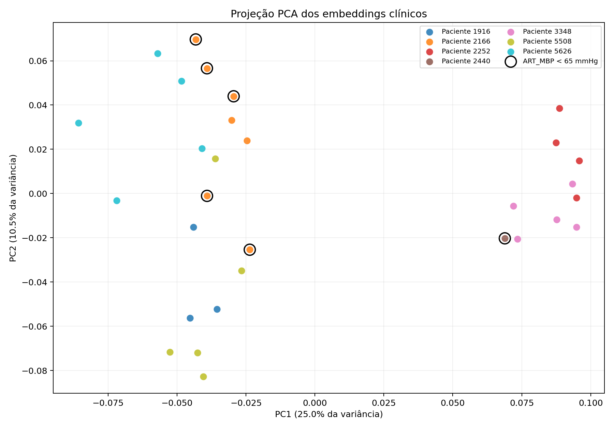
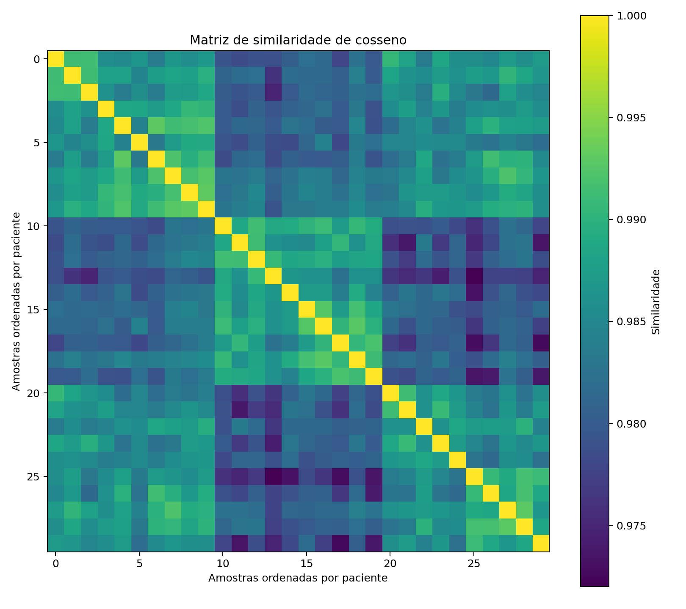

# Aula 05 — Embeddings e busca vetorial no VitalDB

## Objetivo

Aplicar uma abordagem de **embeddings e busca de vizinhos** aos dados tabulares de pressão arterial explorados nas aulas anteriores. Cada aferição é convertida em uma descrição clínica curta, codificada em um vetor e comparada às demais pela similaridade de cosseno.

Esta entrega demonstra geração de embeddings, busca vetorial, visualização e auditoria de possível vazamento entre pacientes. Não se destina ao uso clínico.

## Dados

- Fonte: [VitalDB](https://vitaldb.net/)
- Recorte: 30 aferições válidas de pressão arterial de 7 pacientes, provenientes da tabela analítica da Aula 03.
- Tabela fato: `data/input/fact_bp_measurement_valid.parquet`.
- Dimensões: paciente, tempo, caso e rótulo, em `data/input/`.
- Identificador da amostra: `measurement_id`.
- Identificador do paciente: `patient_id` (derivado de `subject_id`).

Os pequenos Parquets necessários à execução estão incluídos. Os sinais brutos completos do VitalDB não são redistribuídos.

## Abordagem e modelo pré-treinado

- Abordagem: embeddings de descrições clínicas e recuperação dos três vizinhos mais próximos.
- Modelo: [`sentence-transformers/all-MiniLM-L6-v2`](https://huggingface.co/sentence-transformers/all-MiniLM-L6-v2).
- Revisão fixa: `1110a243fdf4706b3f48f1d95db1a4f5529b4d41`.
- Arquivo ONNX: `onnx/model_quint8_avx2.onnx`.
- Versão registrada nas tabelas: `all-MiniLM-L6-v2@1110a243-onnx-int8`.
- Execução: ONNX Runtime em CPU; embeddings normalizados de 384 dimensões.
- Similaridade: cosseno.

O modelo foi usado pronto, sem fine-tuning. A versão ONNX quantizada foi escolhida para permitir execução em CPU no iMac Intel com macOS Big Sur e Python 3.12.

Referências científicas e URLs estão em `references/references.md`; os detalhes do uso do modelo estão em `MODEL_CARD.md`.

## Construção do texto

Cada linha gera uma descrição em inglês contendo sexo, idade, IMC, NIBP sistólica/média/diastólica, frequência cardíaca e tempo relativo do procedimento. O inglês foi escolhido porque o modelo foi treinado principalmente com textos nesse idioma.

Foram excluídos do texto:

- identificadores de amostra e paciente;
- pressão arterial invasiva (ART);
- rótulo de hipotensão;
- resultados do modelo da Aula 04.

Essa decisão evita entregar diretamente ao embedding a identidade do paciente ou a referência usada na interpretação.

## Como reproduzir no macOS

Pré-requisitos: Python 3.12 e internet na primeira execução. No Terminal, entre na pasta do projeto e execute:

```bash
python3.12 -m venv .venv
source .venv/bin/activate
python -m pip install --upgrade pip
pip install -r requirements.txt
python src/run_embeddings.py
```

Na primeira execução, o script baixa automaticamente o tokenizer e os pesos do modelo na pasta `.cache/`. Não há download manual. Execuções posteriores reutilizam o cache.

Ao final, o Terminal deve informar 30 embeddings, dimensão 384 e 90 relações de vizinhança.

## Resultados gerados

| Arquivo | Conteúdo |
|---|---|
| `outputs/embeddings.csv` | IDs, texto, referência do modelo e vetor serializado |
| `outputs/embeddings.parquet` | Mesmas informações, com o embedding como lista numérica |
| `outputs/nearest_neighbors.csv` | Top-3 vizinhos sem restrição de paciente |
| `outputs/nearest_neighbors.parquet` | Versão Parquet da busca de vizinhos |
| `outputs/cross_patient_neighbors.csv` | Top-3 vizinhos obrigatoriamente de outro paciente |
| `outputs/clinical_texts.csv` | Textos enviados ao modelo |
| `outputs/metrics.json` | Métricas estruturadas da auditoria |
| `outputs/embedding_report.md` | Relatório legível com resultados e limitações |
| `figures/embedding_pca_by_patient.png` | Projeção 2D dos embeddings |
| `figures/cosine_similarity_matrix.png` | Matriz de similaridade de cosseno |

## Síntese dos resultados

| Indicador | Resultado |
|---|---:|
| Amostras / pacientes | 30 / 7 |
| Dimensão do embedding | 384 |
| Vizinho top-1 do mesmo paciente | 93,3% |
| Probabilidade aleatória de mesmo paciente | 13,8% |
| Algum vizinho do mesmo paciente no top-3 | 96,7% |
| Top-1 com mesmo rótulo de hipotensão | 80,0% |
| Textos exatamente duplicados | 0 |
| Quase duplicatas entre pacientes, cosseno ≥ 0,995 | 0 |
| Maior similaridade top-1 entre pacientes | 0,9908 |

O valor de 93,3% para vizinhos do mesmo paciente é muito superior aos 13,8% esperados por uma escolha aleatória. Isso indica que as medições repetidas e os atributos constantes do paciente influenciam fortemente o espaço vetorial. Portanto, uma divisão aleatória por linhas poderia colocar aferições muito semelhantes do mesmo paciente em treino e teste e superestimar o desempenho.

A separação por paciente usada na Aula 04 evita esse vazamento: nenhuma medição de um paciente do treino aparece no teste. Também não foram identificados textos idênticos nem pares entre pacientes acima do limiar conservador de 0,995. Similaridades altas abaixo desse limiar ainda devem ser interpretadas com cautela.

## Visualizações

### Projeção PCA



Os pontos são aferições e as cores representam pacientes. O contorno preto identifica hipotensão pela referência invasiva (`ART_MBP < 65 mmHg`). A figura ajuda a visualizar agrupamentos, mas PCA reduz 384 dimensões a apenas duas e pode distorcer distâncias.

### Matriz de similaridade



As amostras estão ordenadas por paciente. Blocos de maior similaridade dentro do mesmo paciente ajudam a explicar a elevada taxa de vizinhos intrapaciente.

## Interpretação e limitações

O método recuperou frequentemente medições do mesmo paciente e, em 80% das consultas, o vizinho top-1 tinha o mesmo rótulo de hipotensão. Isso não comprova capacidade diagnóstica: há somente seis aferições hipotensas, concentradas em dois pacientes, e o rótulo não foi usado no embedding.

Limitações principais:

- o MiniLM foi treinado para linguagem geral, não para distâncias fisiológicas entre números;
- o molde textual é quase igual em todas as linhas, produzindo similaridades globalmente altas;
- a distância textual não garante que diferenças em mmHg tenham o significado clínico adequado;
- a amostra é muito pequena: 30 aferições de 7 pacientes;
- não existe rótulo humano de “vizinhança clinicamente relevante” para validar a recuperação;
- similaridade não implica equivalência clínica, causalidade ou segurança diagnóstica;
- a projeção PCA pode ocultar relações existentes nas 384 dimensões.

Assim, é possível afirmar que o pipeline gera embeddings e vizinhos de forma reproduzível e revela risco de vazamento por paciente. Não é possível afirmar que os vizinhos sejam clinicamente equivalentes nem que o modelo seja adequado para decisão assistencial.

## Estrutura do projeto

```text
aula05_embeddings_vector_search/
├── data/input/                 # Parquets analíticos
├── figures/                    # Visualizações geradas
├── outputs/                    # Tabelas, métricas e relatório
├── references/                # Referências do modelo e do dataset
├── src/run_embeddings.py      # Pipeline executável do zero
├── MODEL_CARD.md               # Ficha do modelo
├── README.md                   # Documentação da entrega
└── requirements.txt            # Dependências fixadas
```
