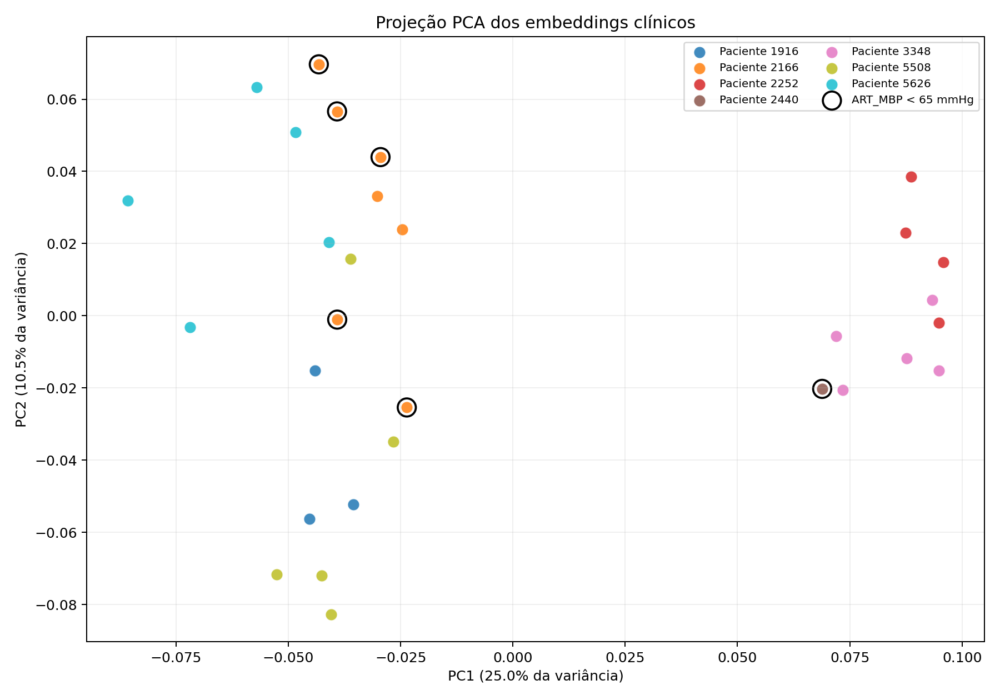
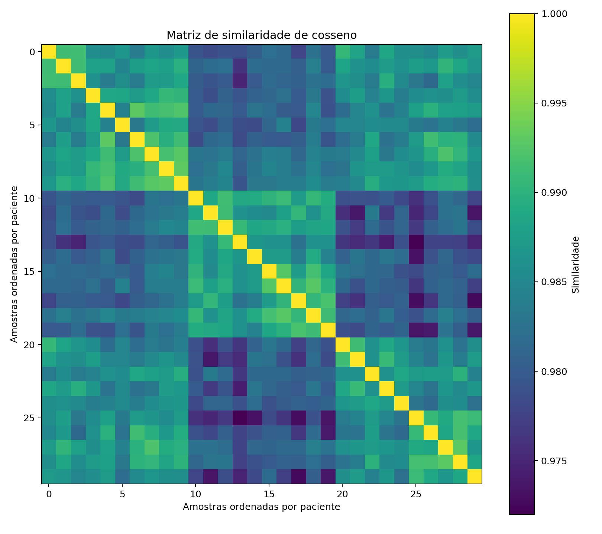

# Resultados — embeddings e busca vetorial

## Configuração

- Modelo: `sentence-transformers/all-MiniLM-L6-v2`.
- Revisão fixa: `1110a243fdf4706b3f48f1d95db1a4f5529b4d41`.
- Versão do artefato: `all-MiniLM-L6-v2@1110a243-onnx-int8`.
- Dimensão: 384.
- Similaridade: cosseno entre embeddings normalizados.
- Amostras: 30; pacientes: 7.

## Resultados descritivos

| Indicador | Resultado |
|---|---:|
| Vizinho top-1 do mesmo paciente | 93.3% |
| Referência aleatória para mesmo paciente | 13.8% |
| Algum vizinho do mesmo paciente no top-3 | 96.7% |
| Top-1 com mesmo rótulo de hipotensão | 86.7% |
| Textos exatamente duplicados | 0 |
| Consultas com possível quase duplicata entre pacientes (≥ 0.995) | 0 |
| Maior similaridade top-1 entre pacientes | 0.9922 |

## Dez pares mais próximos sem restrição de paciente

| query_measurement_id   |   query_patient_id | neighbor_measurement_id   |   neighbor_patient_id |   cosine_similarity | same_patient   | same_hypotension_label   |
|:-----------------------|-------------------:|:--------------------------|----------------------:|--------------------:|:---------------|:-------------------------|
| M-2738-00010           |               2166 | M-2738-00009              |                  2166 |              0.9931 | True           | True                     |
| M-2738-00009           |               2166 | M-2738-00010              |                  2166 |              0.9931 | True           | True                     |
| M-2738-00005           |               2166 | M-2738-00007              |                  2166 |              0.993  | True           | True                     |
| M-2738-00007           |               2166 | M-2738-00005              |                  2166 |              0.993  | True           | True                     |
| M-4191-00020           |               5626 | M-4191-00017              |                  5626 |              0.9928 | True           | True                     |
| M-4191-00017           |               5626 | M-4191-00020              |                  5626 |              0.9928 | True           | True                     |
| M-4974-00025           |               3348 | M-4974-00027              |                  3348 |              0.9928 | True           | True                     |
| M-4974-00027           |               3348 | M-4974-00025              |                  3348 |              0.9928 | True           | True                     |
| M-2738-00010           |               2166 | M-2738-00008              |                  2166 |              0.9927 | True           | False                    |
| M-2738-00008           |               2166 | M-2738-00010              |                  2166 |              0.9927 | True           | False                    |

## Vizinhos de outro paciente — maiores similaridades top-1

| query_measurement_id   |   query_patient_id | neighbor_measurement_id   |   neighbor_patient_id |   cosine_similarity | possible_near_duplicate   | same_hypotension_label   |
|:-----------------------|-------------------:|:--------------------------|----------------------:|--------------------:|:--------------------------|:-------------------------|
| M-2738-00008           |               2166 | M-4191-00020              |                  5626 |              0.9922 | False                     | False                    |
| M-4191-00020           |               5626 | M-2738-00008              |                  2166 |              0.9922 | False                     | False                    |
| M-4191-00019           |               5626 | M-2738-00007              |                  2166 |              0.9914 | False                     | False                    |
| M-2738-00007           |               2166 | M-4191-00019              |                  5626 |              0.9914 | False                     | False                    |
| M-567-00001            |               2252 | M-4974-00025              |                  3348 |              0.991  | False                     | True                     |
| M-4974-00025           |               3348 | M-567-00001               |                  2252 |              0.991  | False                     | True                     |
| M-4974-00027           |               3348 | M-567-00001               |                  2252 |              0.9907 | False                     | True                     |
| M-2769-00015           |               5508 | M-4480-00023              |                  1916 |              0.9906 | False                     | True                     |
| M-4480-00023           |               1916 | M-2769-00015              |                  5508 |              0.9906 | False                     | True                     |
| M-567-00000            |               2252 | M-4974-00026              |                  3348 |              0.9905 | False                     | True                     |

## Visualizações

## Interpretação

A proporção observada de vizinhos de primeiro nível do mesmo paciente foi superior à probabilidade de um vizinho aleatório pertencer ao mesmo paciente. Isso sugere que características repetidas do paciente e o contexto fisiológico influenciaram a vizinhança.

As descrições excluíram ART, rótulos, IDs e resultados anteriores. Assim, a busca não recebeu diretamente a resposta nem a identidade do paciente. Mesmo assim, sexo, idade e IMC se repetem dentro do paciente e podem aproximar suas aferições. Em uma divisão aleatória por linha, esses pares poderiam aparecer em treino e teste e produzir estimativas otimistas. A divisão por paciente usada na Aula 04 impede esse vazamento: medições do mesmo paciente nunca cruzam treino e teste.

O rótulo de hipotensão foi usado apenas para interpretação. A concordância entre vizinhos não demonstra capacidade diagnóstica, principalmente porque há somente seis aferições hipotensas concentradas em dois pacientes e predominância da classe não hipotensa.

## Onde a abordagem pode errar

- O MiniLM foi treinado para semântica de linguagem geral, não para distância fisiológica entre números.
- O molde textual é quase igual em todas as linhas; pequenas diferenças numéricas podem produzir similaridades muito altas.
- Uma diferença de 10 mmHg não possui necessariamente no espaço textual o significado clínico esperado.
- A projeção PCA reduz 384 dimensões a duas e pode ocultar ou distorcer relações.
- A amostra tem apenas 30 aferições de sete pacientes.
- Similaridade não implica equivalência clínica, causalidade ou segurança diagnóstica.

Sem validação externa e sem um conjunto rotulado especificamente para relevância de vizinhos, não é possível afirmar que os pares recuperados sejam clinicamente equivalentes. A atividade demonstra corretamente a geração de embeddings, a busca vetorial e a auditoria de vazamento, mas não valida o modelo para uso assistencial.
