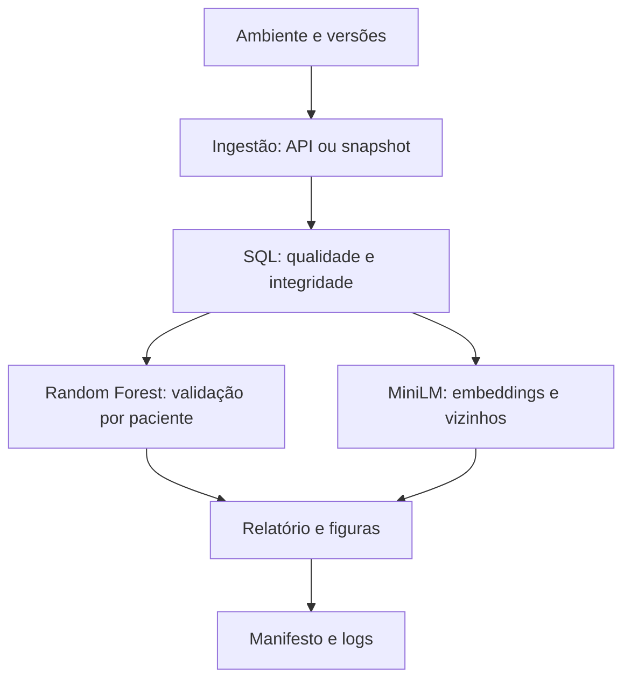

# Projeto final — Engenharia de Dados | PPGEB/UFU

**Eduardo Coura Assis** · 2026

**Engenharia de dados e inteligência artificial aplicadas à avaliação exploratória da concordância da pressão arterial não invasiva: pipeline reprodutível com VitalDB.**

## Pergunta, dados e FAIR (Aula 01)

Qual a concordância da pressão arterial não invasiva (NIBP) com a invasiva (ART) e o desempenho exploratório de um modelo que estima a PAM invasiva? Uma amostra é uma atualização aparente de NIBP pareada à ART mais próxima no mesmo caso (até 30 s). Identificar atualizações por mudanças de valor é uma aproximação, não garante aferições independentes. Alvo: ART_MBP; rótulo exploratório: ART_MBP < 65 mmHg. Entradas: NIBP sistólica/média/diastólica, FC, sexo, idade, altura, peso, IMC, tempo relativo. Não se usa horário civil nem ART como entrada.

- VitalDB v1.0.0: https://physionet.org/content/vitaldb/1.0.0/ (DOI https://doi.org/10.13026/czw8-9p62); Lee et al., Scientific Data 2022, https://doi.org/10.1038/s41597-022-01411-5.
- Extração efetiva via https://api.vitaldb.net/ (script original da Aula 02). A ficha histórica distingue CC BY 4.0 no PhysioNet de CC BY-NC-SA 4.0 e termos adicionais no portal VitalDB. Respeitar os termos da fonte efetivamente utilizada; uso acadêmico, atribuição, sem tentativa de reidentificação. Os dados desidentificados ainda têm risco residual; não redistribuir o dataset integral.
- A EDA original (notebook em `reference/`) foi feita com outra estratégia de pareamento/medidas repetidas; seus 12.026 registros não equivalem às 30 aferições do recorte da Aula 02. Não combinar as métricas dessas amostras.

| FAIR (escala 0–4) | Nota | Justificativa |
|---|---:|---|
| Findable | 4 | DOI, versão, artigo, metadados indexáveis |
| Accessible | 4 | Acesso seletivo por API e download; volume integral grande |
| Interoperable | 3 | CSV, unidades documentadas; formato .vital especializado |
| Reusable | 3 | Dicionário, artigo e termos publicados; divergência entre portais e falta de metadados clínicos |

Nota qualitativa 14/16 conforme ficha da Aula 01; detalhes em `reference/FICHA_TECNICA.md`. Centro único cirúrgico, seleção de casos com ART e NIBP, amostra de conveniência, artefatos e ausência de informação de manguito/posicionamento limitam generalização.

## Execução (Aula 06)

Python 3.12, macOS Intel ou Linux. No Terminal, na pasta que contém este README:

```bash
python3.12 -m venv .venv
source .venv/bin/activate
python -m pip install -r requirements.txt
python run_pipeline.py
```

No Windows, use `py -3.12 -m venv .venv` e `.venv\Scripts\activate`; os demais comandos são iguais. A primeira instalação precisa de internet. A execução padrão importa os Parquets históricos (30 aferições/7 pacientes), refaz a qualidade, treina e avalia o modelo, gera novos embeddings com o MiniLM baixado automaticamente, refaz a busca e cria gráficos e relatório. Não faz novo download das trilhas do VitalDB nesse modo. A versão ONNX AVX2 é voltada a CPUs x86 com AVX2, como o iMac Intel testado na Aula 05.

Para refazer a ingestão original dos dados brutos, execute:

```bash
python run_pipeline.py --source api
```

Esse modo baixa os metadados e trilhas dos oito casos declarados no código e no config, via HTTPS, filtra, pareia, grava CSV/Parquet ZSTD, constrói o DuckDB e executa as consultas. A API pode mudar; o recorte histórico incluído mantém a referência original. O manifesto registra hashes das entradas. Não se exige 30 linhas para o modo API, mas os scripts originais podem precisar revisão caso os dados/formatos mudem.

Se não for possível baixar o MiniLM, há reprodução parcial explícita:

```bash
python run_pipeline.py --embeddings archived
```

Nesse modo o modelo Random Forest é treinado novamente, enquanto os vetores MiniLM previamente gerados são conferidos por ID, texto, rótulo, versão, dimensão e norma, e reutilizados para recalcular a busca e figuras. Não afirmar que houve nova inferência MiniLM. O modo histórico não pode ser combinado com uma nova extração API. As saídas originais permanecem em `source/`.

Cada execução cria uma pasta exclusiva `runs/<timestamp>/`, com `pipeline.log`, `run_manifest.json`, saídas das etapas e `summary/RELATORIO_FINAL.md`. O manifesto registra versões instaladas, configuração de referência, hashes de entrada/código, início/fim/duração, status (success/failed) e métricas. O orquestrador interrompe em erro; não usa resultados antigos silenciosamente. Os parâmetros efetivos estão nos scripts originais; `config.json` é o registro declarativo da configuração histórica, não um seletor editável de casos. O ambiente fixa dependências diretas no requirements; versões transitivas podem variar. A pasta `source` conserva os scripts e artefatos originais do commit `d0107cfdb18da96bcc53165a5187dd8342aa2d4a` (ZIP do GitHub). Não sobrescreve as aulas anteriores.

## DAG de orquestração



As duas etapas de IA dependem dos mesmos dados validados; são executadas sequencialmente por `run_pipeline.py`, sem dependência de resultados entre si. O log e manifesto são atualizados em todas as etapas, não apenas ao final.

## Pipeline de dados e esquema estrela (Aulas 02–03)

API → CSV de metadados/trilhas → seleção dos casos → remoção de repetições consecutivas da PAM NIBP → pareamento temporal → plausibilidade → Parquet → DuckDB/SQL. O modo snapshot começa nos Parquets produzidos pela Aula 02. Identificadores textuais, pressão em float32, chave tempo int64, rótulos booleanos, nulos reais; schema em `source/aula02_etl_duckdb/metadata/schema.json`. A fato contém `measurement_id` (PK) e as FKs abaixo.

| Dimensão | Chave | Dados |
|---|---|---|
| Paciente | patient_key | sexo, idade, peso, altura, IMC |
| Caso | case_key | cirurgia, anestesia, departamento |
| Tempo | time_key | segundos/minutos relativos |
| Rótulo | label_key | hipotensão NIBP/ART e concordância |

Fato: uma atualização aparente da NIBP pareada à ART, medidas em mmHg, FC, diferença temporal e erro NIBP−ART. Dimensões normalizam atributos repetidos; tabela analítica desnormalizada por joins apenas para análise. SQL testa nulos, duplicatas, plausibilidade, consistência de rótulos, integridade; registros críticos vão à quarentena, métricas à camada Gold. Os sinais brutos e imagens não entram no Parquet.

## IA e avaliação (Aula 04)

RandomForestRegressor, `rf_art_mbp_v1.0`, scikit-learn 1.5.2. Referência Breiman (2001), https://doi.org/10.1023/A:1010933404324. Imputação mediana/moda e one-hot dentro de cada fold; 300 árvores, min_samples_leaf=2, seed 42. Leave-One-Patient-Out em sete pacientes, cada aferição predita exclusivamente por modelo que não viu aquele paciente. Comparação com NIBP direta; MAE, RMSE, viés, R² e IC95% via bootstrap por paciente; métricas de hipotensão derivada do limiar exploratório. Modelo final treinado em todos os dados é salvo apenas para reprodução, não para avaliação. Consulte `summary/RELATORIO_FINAL.md` para exemplos e figuras gerados. O resultado histórico do RF foi MAE 11,18 e RMSE 17,19 mmHg, pior que NIBP direta (8,03 e 15,56); sensibilidade 0% sob o limiar exploratório. Resultado acadêmico negativo, não validação clínica.

## Embeddings (Aula 05)

`sentence-transformers/all-MiniLM-L6-v2` — https://huggingface.co/sentence-transformers/all-MiniLM-L6-v2; revisão `1110a243fdf4706b3f48f1d95db1a4f5529b4d41`, ONNX quantizado, 384 dimensões, cosseno. Descrição inglesa padronizada das variáveis clínicas; exclui IDs, ART e rótulos. Busca top-3 geral e interpaciente, PCA e matriz de similaridade. Referência Sentence-BERT (Reimers & Gurevych, 2019), https://arxiv.org/abs/1908.10084. No ZIP definitivo do GitHub: 93,3% de vizinhos top-1 do mesmo paciente versus 13,8% ao acaso; nenhuma quase duplicata entre pacientes no limiar 0,995; concordância de rótulos 86,7% (26/30), descritiva. O README antigo citava 80%; a fonte de verdade é o arquivo metrics.json e os vetores efetivamente publicados, que reproduzem 86,7%. Resultados de nova inferência podem variar entre plataformas. Alta similaridade pode ocorrer apesar de rótulos diferentes; linguagem geral e molde fixo não representam necessariamente diferenças fisiológicas numéricas. A separação por paciente evita a sobreposição intrapaciente no ML, não garante ausência de dependências externas. Não há treino de embeddings.

## Entrega e rastreabilidade

Os arquivos de referência e as saídas históricas foram preservados. Os relatórios das novas execuções são independentes e não substituem as referências. Não publicar ambiente virtual, cache de pesos, trilhas brutas ou identificadores desnecessários; compartilhar preferencialmente código e métricas agregadas, observando os termos aplicáveis. Este projeto é exclusivamente didático, sem validação clínica ou regulatória.

O diretório `evidence/` contém os resultados de testes do pipeline integrado executados em 26/11/2026 em Linux com Python 3.12. A execução com nova inferência MiniLM e a alternativa com vetores históricos foram testadas sobre o snapshot. A extração integral **via API** não foi reexecutada nesta validação; o script original da Aula 02 permanece disponível para fazê-la. A nova inferência obteve 80% de concordância de rótulo top-1, enquanto o replay dos vetores do GitHub obteve 86,7%; em ambos, top-1 intrapaciente foi 93,3%. Essa diferença é observada entre execuções, sem atribuir causa específica sem investigação adicional. Para a apresentação, identifique sempre a execução de referência e não misture os números.
