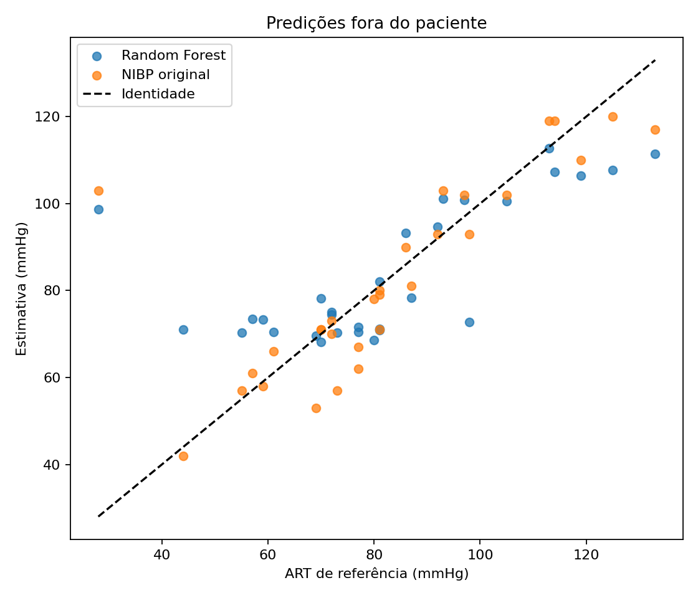
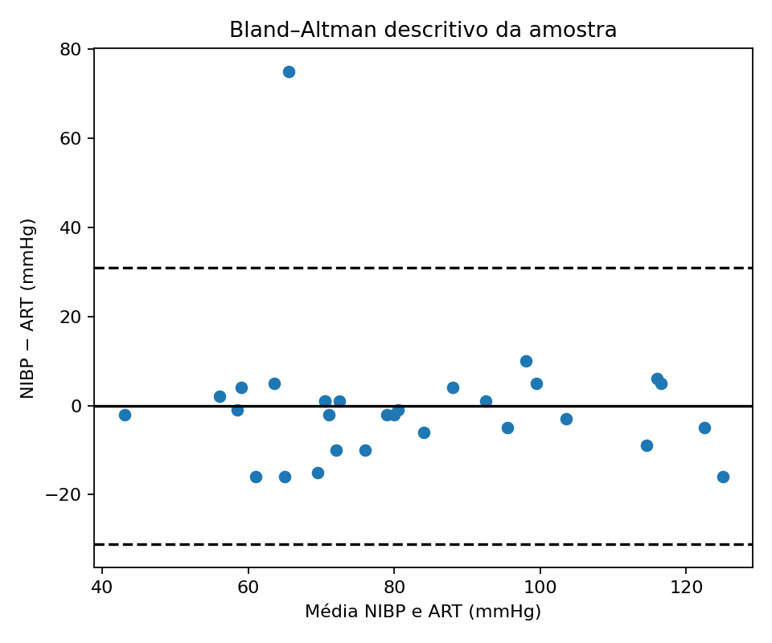
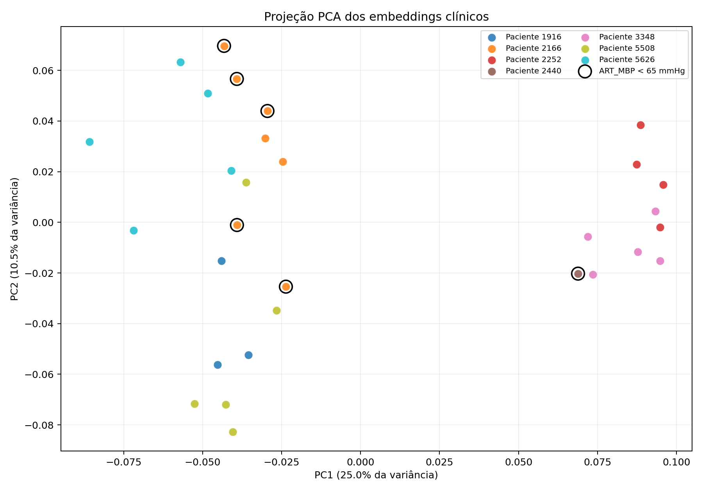

# Síntese da execução

- Fonte: snapshot; embeddings: archived (archived = vetores históricos, não nova inferência).
- 30 aferições válidas, 7 pacientes; 0 em quarentena.
- Separação Leave-One-Patient-Out, 7 folds, sem sobreposição registrada.

## Avaliação do Random Forest (PAM invasiva como alvo)

| metodo        | metrica   |   valor |   IC95 inferior |   IC95 superior |
|:--------------|:----------|--------:|----------------:|----------------:|
| Random Forest | mae_mmhg  |  11.176 |           7.239 |          18.423 |
| Random Forest | rmse_mmhg |  17.19  |           9.407 |          28.918 |
| NIBP original | mae_mmhg  |   8.033 |           4.079 |          16.913 |
| NIBP original | rmse_mmhg |  15.56  |           5.444 |          29.767 |

O limiar exploratório de hipotensão é ART < 65 mmHg. Matriz de confusão do Random Forest: VP=0, VN=24, FP=0, FN=6; sensibilidade=0.0%, especificidade=100.0%, acurácia balanceada=50.0%. Não confundir acurácia simples com desempenho em classes raras.

Exemplos de menores e maiores erros absolutos:

| measurement_id   |   art_mbp_reference_mmhg |   art_mbp_predicted_mmhg |   absolute_error_mmhg |
|:-----------------|-------------------------:|-------------------------:|----------------------:|
| M-2769-00011     |                      113 |                   112.75 |                  0.25 |
| M-4974-00027     |                       69 |                    69.61 |                  0.61 |
| M-2738-00007     |                       44 |                    71    |                 27    |
| M-5502-00029     |                       28 |                    98.7  |                 70.7  |

## Embeddings

- Top-1 mesmo paciente: 93.3%; acaso: 13.8%.
- Top-1 com mesmo rótulo: 86.7% (concordância descritiva, não diagnóstico).
- Textos duplicados: 0; consultas com possível quase duplicata interpaciente: 0.

Exemplos de vizinhos entre pacientes com rótulos divergentes:

| query_measurement_id   | neighbor_measurement_id   |   cosine_similarity | same_hypotension_label   |
|:-----------------------|:--------------------------|--------------------:|:-------------------------|
| M-2738-00008           | M-4191-00020              |              0.9922 | False                    |
| M-4191-00020           | M-2738-00008              |              0.9922 | False                    |
| M-4191-00019           | M-2738-00007              |              0.9914 | False                    |

## Limitações

A amostra pequena e as medidas repetidas restringem inferência. O intervalo bootstrap por paciente é exploratório; Bland–Altman simples não ajusta a dependência intrapaciente. A ART pode ter artefatos; a associação temporal, o molde textual e a baixa sensibilidade do modelo limitam a interpretação. Similaridade textual não equivale a relevância fisiológica. Não há validação clínica ou regulatória do equipamento.
